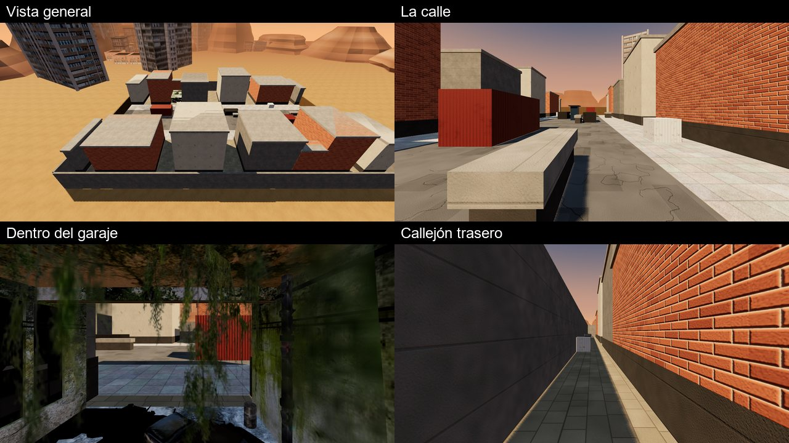

# BARRIO: mapa de calle con los garajes y las torres del material del 04-11-2026

**Estado (04-11-2026):** IMPLEMENTADO · PROBADO EN NAVEGADOR · PROBADO ONLINE (servidor local) · PENDIENTE DE APROBACIÓN Y DE
VALIDACIÓN EN IPHONE. Solo sale con `?barrio=1` (se recuerda en el dispositivo; `?barrio=0` lo oculta). El servidor ya lo
tiene (mapa `barrio`), así que se puede jugar online.

## De dónde sale
- **Encargo:** el propietario dejó material en `COSAS DEL JUEGO/MATERIAL 04 11` («que añadas, implementes a pueblo, o añadas
  nuevo mapa, o juntes todo»). Tras el triaje eligió «mapa con torres y garaje».
- **La calle abandonada no se usa.** Vista de cerca era borrosa y estaba hecha de bloques: es un modelo para verse de lejos
  (`docs/img/material-04-11.jpg`).
- **Lo que sí se usa** (los dos de dasy444 en Sketchfab, licencia Sketchfab Standard: uso en juegos permitido):
  - «an abandoned garage»: un garaje en ruinas a escala real (6,3 × 3,6 m, techo a 2,3 m), abierto por un lado, con un
    coche quemado, escombros, columnas y hiedra. Hay dos, uno en cada fila, abiertos a la calle.
  - «street city (7) for games FREE»: bloques de pisos. Se agrandan ×3,5 (unos 43 m) y hacen de horizonte detrás de los
    edificios. Nunca se pisan.
- Todo lo demás son cajas con texturas.
  - Desde el 05-11, el ladrillo, los bloques de hormigón y las losas de las aceras son escaneos 4K del material del
    propietario (`docs/ASSETS-3D.md` §23).
  - El resto (estuco, metal, asfalto y losas del callejón) son del juego.

## Plano (56 × 40 m, simétrico por el centro)
- Calle de asfalto de 10 m, con aceras de 3,5 m a cada lado.
- Dos filas de edificios de 6 a 10 m, con callejones de 2,2 a 4 m. En cada fila, el garaje se mete entre dos edificios.
- Detrás de cada fila, un callejón trasero de 2,6 m para flanquear.
- Salidas: en el extremo de cada callejón trasero (A al noroeste, B al sureste), a 65 m y sin verse.
- Coberturas en la calle, cada una con su gemela al otro lado:
  - un contenedor de barco;
  - dos barreras de hormigón de 1,05 m (se cubre agachado y se dispara de pie por encima);
  - un coche quemado;
  - un contenedor de basura;
  - cajas;
  - el quiosco del centro.

  En el callejón trasero, cajas y otro contenedor.
- Los extremos de la calle se cierran con vallas de obra de 3 m.

## Integración
- `client/barrio.js`: las cajas (movimiento y balas), las salidas, la red de los bots y `build()`, que dibuja las cajas y
  coloca los dos modelos.
- El garaje lleva cajas nuestras: paredes, tabique del fondo, techo, columna, el coche y el montón de escombros alto. Los
  escombros bajos (≤ 0,36 m) se pisan.
- `tools/barrio/pack.py` empaqueta cada glTF de Sketchfab en un GLB, en `assets/maps/barrio/`:
  - `garaje.glb`: 5,9 MB, texturas a 1024 px;
  - `torres.glb`: 6,6 MB, texturas a 512 px, sin sus suelos ni bolardos.
- La página junta cada modelo en una malla por material (los dos garajes juntos y los dos horizontes juntos).
- El horizonte del sur solo se dibuja en ALTO.

## Medido
- **Pruebas:**
  - `node test/barrio.test.js` (13):
    - simétrico y cerrado;
    - salidas a 65 m sin verse;
    - una sola red de bots, también la del servidor;
    - tres rutas de 78, 82 y 82 m (calle, callejón norte, callejón sur);
    - los dos garajes accesibles;
    - líneas de tiro de hasta 54 m.
  - `node test/barrio.browser.test.js` (8):
    - carga y empieza en la salida A con 2 bots, sin errores;
    - sin paredes invisibles (228 de 228 caras, desde donde se puede estar de pie);
    - edificios, muros y coberturas a ±3 cm de su caja (114 de 114);
    - los bots se mueven 40 s sin meterse en nada.
  - `node test/casa2.online.browser.test.js --barrio` (13): dos navegadores contra el servidor; el impacto cruzando la
    calle cuenta y el edificio para la bala.
- **Rendimiento** en el PC (GPU GTX 1050 Ti, 1280 × 720; **no vale como FPS del iPhone**):

  | | Descarga | Llamadas | Triángulos | ms/fotograma |
  |---|---|---|---|---|
  | BARRIO, ALTO | 12,4 MB | 106 | 327 mil | 10,9 |
  | BARRIO, MEDIO | 12,4 MB | 104 | 238 mil | 8,1 |
  | CASA ATLAS 2.0, ALTO | 1,8 MB | 74 | 86 mil | 10,2 |

  La mayoría de los triángulos son de las torres (86 mil cada horizonte) y los garajes (29 mil cada uno).
- **Pendiente:**
  - los edificios son cajas sin ventanas (desde el 05-11, con ladrillo y bloques escaneados);
  - las paredes laterales del garaje son planos en su modelo: de canto, en el borde de su entrada, hay 11 cm sin dibujo.

## Herramientas
- `node tools/barrio/capturas.js CARPETA`: vistas aérea, de la calle, del garaje, del callejón y de las torres.
- `GPU=1 node tools/casa2/medir.js`: la tabla de rendimiento (incluye `barrio`).
