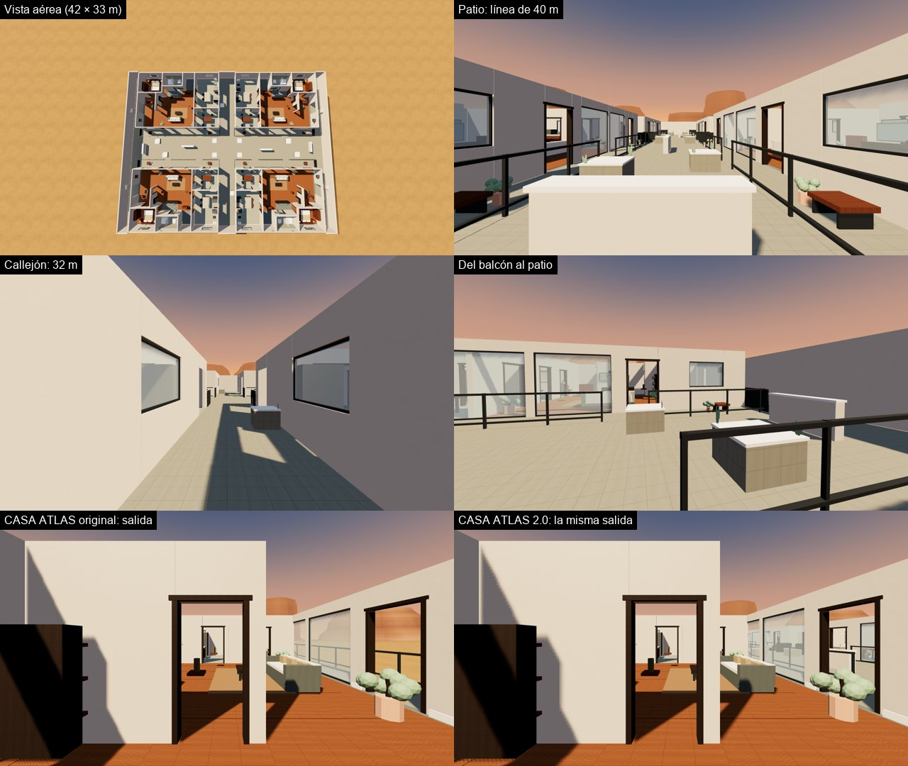
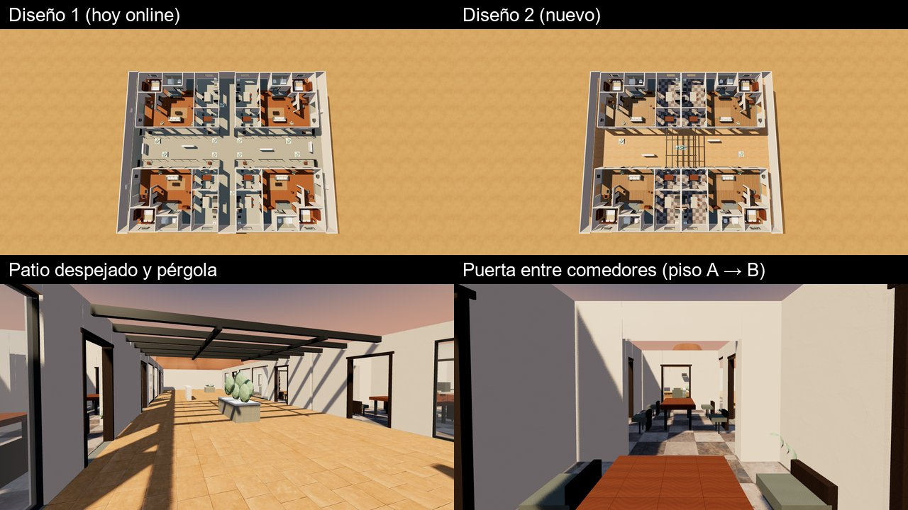

# CASA ATLAS 2.0: cuatro CASA ATLAS unidas en un complejo para el 1v1 (02-11-2026)

**Estado (03-11-2026):** APROBADA por el propietario («Aprobada, súbela online») · PUBLICADA en el duelo y ONLINE ·
servidor desplegado (`b7f5524`, comprobado en el servidor público: una sala en CASA ATLAS 2.0) · CASA ATLAS XL retirada
(punto de recuperación: `b7f5524`) · VALIDADO EN IPHONE por el propietario (04-11: «todo bien»). Sale por defecto en los menús; `?casa2=0` la oculta
en ese dispositivo.

El encargo (el propietario, 02-11): «amplía la CASA ATLAS original que ya me gusta, sin rehacerla: duplica sus módulos,
reutiliza sus materiales, conéctalos… un complejo residencial con rutas, flanqueos, obstáculos, habitaciones y líneas de
visión para francotiradores». Se retira la CASA ATLAS XL de ChatGPT cuando la 2.0 esté aprobada.



## Qué es
Cuatro copias de la CASA ATLAS original (el mismo `assets/maps/casa_atlas/casa_atlas.glb` y las mismas cajas de
`client/casa.js`), sin rehacer nada, en 2 × 2 alrededor de un patio:

```
       x −21,3 ……………………………………………………………… +21,3
z −16,4 ┌────┬──────────────┬─────┬──────────────┬────┐
        │ P  │ A (salida A) │  C  │ B (espejo)   │ P  │   A  tal cual             (noroeste)
        │ A  │   balcón     │  A  │   balcón     │ A  │   B  espejo en x          (noreste)
        │ S  ├──────────────┤  L  ├──────────────┤ S  │   C  espejo en z          (suroeste)
        │ I  │ PATIO: 5 m entre barandillas, 42 m de largo  │   D  girada 180°          (sureste, salida B)
        │ L  ├──────────────┤  L  ├──────────────┤ I  │
        │ L  │   balcón     │  E  │   balcón     │ L  │   Simétrico por el centro (A ↔ D, B ↔ C):
        │ O  │ C (espejo)   │  J  │ D (salida B) │ L  │   los dos jugadores tienen exactamente el
z +16,4 └────┴──────────────┴─────┴──────────────┴────┘   mismo mapa
```

- **Tamaño:** 43 × 33 m (el encargo decía unos 40 × 32).
- **Cada piso conserva** sus habitaciones, muebles, cristaleras, materiales PBR y luces. Los espejos y el giro hacen que las
  cuatro no se vean iguales al recorrerlas.
- **Tres aperturas por piso** (se quitan los triángulos y las cajas de colisión; no quedan paredes invisibles ni agujeros):
  - la ventana del **comedor** pasa a ser una puerta al **callejón** entre pisos (2,3 m de ancho). No se usó la de la
    cocina: entre su isla y la encimera solo quedan 0,85 m;
  - la ventana del **estudio** pasa a ser una puerta al **pasillo lateral**. El estudio de cada salida tiene así tres salidas:
    pasillo, salón y dormitorio;
  - dos **huecos en la barandilla** del balcón, delante de sus puertas, bajan al patio (1,64 m entre postes).
  - También se quitan las macetas que quedaban delante de las puertas nuevas. Las hojas de la del estudio se reutilizan
    como arbustos de las jardineras.
- **Piezas nuevas**, con los materiales del piso (estuco, piedra del balcón, remate blanco, metal de la barandilla, hojas):
  - los muros del límite;
  - el suelo del patio, del callejón y de los pasillos;
  - 4 muretes de 1,05 m (cubren agachado; de pie se dispara por encima);
  - 10 jardineras de piedra de 1,1 m con arbusto;
  - 4 contrafuertes en los pasillos.
  - Cada pieza sólida tiene su caja de balas y de movimiento, y la prueba comprueba que coinciden a ±3 cm.
- **Salidas:** el estudio del piso A y el del D, a 39,8 m, sin verse (paredes en medio) y con 0,6 m libres alrededor.

## Rutas y distancias
| Ruta | Por dónde | Longitud entre salidas |
|---|---|---|
| A · interior | estudio → salón → comedor → **callejón** → comedor → salón → estudio | 49 m |
| B · patio | salón → balcón → **patio** (coberturas) → balcón → salón | 63 m |
| C · flanco | estudio → **pasillo lateral** → piso de al lado → callejón → piso de la otra salida | 60 m |

- Cada ruta se comprueba sin pasar por las otras dos. Ninguna es mucho más corta (como mucho 1,3 veces).
- Todas siguen abiertas exigiendo 0,5 m de margen a cada lado del cuerpo: puertas de 1 m o más.
- **Líneas de tiro** (rayos a 1,6 m entre puntos al azar; el cristal y las barandillas no tapan, como en el juego):

  | | Media | Máxima | Más de 25 m |
  |---|---|---|---|
  | CASA ATLAS original | 6,1 m | 18,6 m | — |
  | CASA ATLAS 2.0 | 13,5 m | 42,3 m | ~10 % |

  Además hay un ~50 % de líneas de 10–25 m. Las largas son el patio de punta a punta (40 m), el callejón y los pasillos
  (32 m) y de una cristalera a la de enfrente.
- **Cobertura en el patio:** ningún punto a más de 6 m de un murete o una jardinera.

## Rendimiento (medido en el PC, `node tools/casa2/medir.js`)
Mismas 3 vistas por mapa, 1280 × 720. Con `GPU=1` es la GPU del PC: **no** vale como FPS del iPhone.

| | Descarga del mapa | Lista en | Llamadas | Triángulos (escena) | ms/fotograma PC (ALTO) | Texturas añadidas |
|---|---|---|---|---|---|---|
| CASA ATLAS | 1,8 MB | 0,7 s | 66 | 48 mil | 6,9 | — |
| **CASA ATLAS 2.0** | **1,8 MB (el mismo GLB)** | **0,5 s** | 70 | 86 mil | 6,3 | **0 MB (las mismas texturas)** |
| CASA ATLAS XL | 6,3 MB | 2,8 s | 74 | 87 mil | 10,0 | +19 MB |

- **Cómo se consigue:** los 32 trozos del GLB se juntan, cada uno con sus 4 copias, en una sola malla con el MISMO objeto de
  material. Las texturas, los materiales y los shaders son los de CASA ATLAS y están una vez en la GPU. Solo se añaden
  vértices (~42 mil triángulos del complejo, ~4 MB).
- En MEDIO y BAJO pasa lo mismo: 0 MB de texturas nuevas; la XL añade 19 MB.
- Los ms del PC varían mucho entre ejecuciones (había otra sesión trabajando a la vez); sirven para comparar, no como cifra.
- La red de los bots (11 000–12 000 puntos) tarda ~50–80 ms en construirse y solo se construye con `?casa2=1`.

## Pruebas
- `node test/casa2.test.js` (24, sin navegador):
  - cajas, simetría por el centro y tamaño;
  - salidas: distancia, que no se vean, espacio libre, mirada y 3 salidas;
  - un solo trozo de red y todas las habitaciones con puntos;
  - las tres rutas y las puertas de 1 m;
  - líneas de tiro y cobertura en el patio.
- `node test/casa2.browser.test.js` (19, en la página):
  - sin la bandera no existe; con ella sale en el menú del duelo y no en el online;
  - carga y empieza en la salida A con 2 bots;
  - los mismos materiales que CASA ATLAS;
  - lo que se ve coincide con las cajas, y las 8 puertas abiertas para la vista, las balas y el cuerpo;
  - muretes, jardineras y cristaleras con las balas;
  - bots 40 s: se mueven 75–86 m, nunca dentro de una caja.
- Herramientas:
  - `node tools/casa2/capturas.js CARPETA`: vista aérea, patio, callejón, pasillo, salidas y comparación con la original
    (imágenes en `docs/img/casa2/`);
  - `node tools/casa2/medir.js`: la tabla de arriba;
  - `tools/casa2/glb.js`: lector de GLB para auditar piezas.

## Online (03-11-2026)
- `core/mapdata.js` lleva `casa2`: sus 434 cajas, 4010 triángulos de bala, las salidas A y B y una red para los bots del
  servidor de un punto cada 0,5 m (3073 puntos, un solo trozo con la regla de enlace de sus bots; `SDCasa2.thin`).
- `core/protocol.js`: los ids de mapa admiten cifras (`casa2`).
- La página construye siempre el mundo (un invitado puede entrar en una sala en él); su red de 11 000 puntos se crea la
  primera vez que se pide.
- `node test/casa2.online.browser.test.js` (13): dos navegadores contra el servidor Node real: elegir el mapa, salidas,
  impacto a través del patio, la pared del estudio lo para, muerte y reaparición dentro del complejo.
- Balística, daño y zonas de impacto: sin cambios.

## CASA ATLAS XL: retirada (03-11-2026)
- Se quitaron:
  - `client/casaxl.js` y su línea en `build.py`;
  - el bloque de `src/page.html` (`XL`, `casaxlLoad`, `xlRetex`, `?xlv`, `?xltex`, el botón del menú, `duelCasaXL`);
  - `test/casaxl.browser.test.js` y su línea en `package.json`;
  - `tools/casa/make_casaxl_js.py`;
  - `assets/maps/casa_atlas_xl/`.
- MEDIR RENDIMIENTO mide ahora la CASA ATLAS 2.0 como tercera escena.
- El menú 2 (otra sesión) cambió su tarjeta por la de la 2.0 (`5ca53d0`).
- El servidor nunca la tuvo: no cambia.
- **Se conservan:**
  - las entregas originales de ChatGPT en `assets/3d/imports/2026-10-18_casa_atlas_xl/` y `2026-10-19_casa_atlas_xl_v2/`
    (fuentes e historia; Codex tiene cambios sin confirmar en la segunda: borrarlas es decisión del propietario);
  - los documentos antiguos que la mencionan.
- **Recuperarla:** `git checkout b7f5524 -- client/casaxl.js assets/maps/casa_atlas_xl test/casaxl.browser.test.js` y el bloque
  de `src/page.html` de ese commit.

## Diseño 2 (04-11-2026): más conectado y más libre · PENDIENTE DE APROBACIÓN
Del propietario, tras probarla (con vídeo): «hay demasiados obstáculos para poder moverse libremente, y el diseño es muy simple;
ajusta las casas, que estén más conectadas, que no sean literalmente 4 casas en cuatro esquinas. Y mejora CASA ATLAS 2.0 en
general, tema texturas, también el cristal».



- **Cómo verlo:** `?casa2v=2` (se recuerda en el dispositivo; `?casa2v=1` vuelve al diseño 1). Sale como «CASA ATLAS 2.0 ·
  NUEVA» en el menú del duelo, en el online y en MAPAS. Para el servidor es otro mapa (`casa2b`), así que las salas en el
  diseño 1 no cambian. Si se aprueba, pasa a ser «CASA ATLAS 2.0» para todos y el diseño 1 se retira.
- **Qué cambia** (`client/casa2.js` → `SDCasa2.v2`):
  - **Sin callejón:** los pisos A y B (y C y D) quedan espalda con espalda.
    - Son **dos casas grandes**, cada una unida por dentro con **dos puertas** en la pared común: de comedor a comedor y de
      cocina a cocina.
    - Ya no son cuatro casas sueltas.
  - **Fuera obstáculos:**
    - las barandillas del balcón, también las laterales;
    - los bancos y las macetas del balcón;
    - la mesa baja del salón;
    - la isla de la cocina, que pasa a ser un paso.

    El balcón se abre entero al patio.
  - **Patio de casa a casa** (8,6 m entre las cristaleras y 35 m de largo), con **5 coberturas** en lugar de 14 más
    4 contrafuertes:
    - un seto de 2 m en el centro, que tapa la diagonal entre las salidas;
    - a cada lado, un murete de 1,05 m y una jardinera de 1,1 m.
  - **Pérgola** de metal oscuro sobre el centro del patio, de una casa a la otra. Va por encima de la cabeza; las balas sí la
    tocan.
  - **Pasillos laterales despejados**, sin contrafuertes.
  - **Tamaño:** 39,6 × 33,1 m.
  - **Texturas y cristal** (solo en este diseño):
    - parqué, damero de piedra y baldosa de barro, escaneados de Poly Haven (CC0);
    - un cristal casi transparente que refleja más el cielo cuanto más de lado se mira.

    Detalle en `docs/ASSETS-3D.md` §21.
- **Medido** (`node test/casa2v2.test.js`, 33 comprobaciones):

  | | Diseño 1 | Diseño 2 |
  |---|---|---|
  | Cajas que estorban a la altura del cuerpo | 262 | 227 |
  | Coberturas en el patio | 14 + 4 contrafuertes | 5 |
  | Parte del patio y los balcones por la que se puede andar | — | 91 % |
  | Rutas entre salidas (por dentro / patio / flanco) | 49 / 63 / 60 m | 42 / 42 / 56 m |
  | Líneas de tiro: media · máxima | 13,5 · 42,3 m | 12,4 · 37,4 m |
  | Salidas | a 39,8 m, sin verse | a 36,8 m, sin verse |
  | Llamadas de dibujo · triángulos (vistas a la altura de los ojos) | ~50 · 39 mil | ~51 · 39 mil |
  | PC, GPU, ALTO (`GPU=1 node tools/casa2/medir.js`; no vale para el iPhone): ms/fotograma · triángulos · texturas del mapa | 9,2 ms · 86 mil · 30,8 MB | 7,6 ms · 73 mil · 36,1 MB |

- **Pruebas nuevas:**
  - `test/casa2v2.test.js`, sin navegador: 33;
  - `test/casa2v2.browser.test.js`, en la página: 22;
  - `node test/casa2.online.browser.test.js --v2`, dos navegadores contra el servidor: 13.
- **Capturas:** `MAP=casa2b node tools/casa2/capturas.js CARPETA` → `docs/img/casa2/v2-*.jpg`.

## Validación
- 04-11-2026: el propietario la probó en el iPhone y dio el visto bueno («todo bien»).
