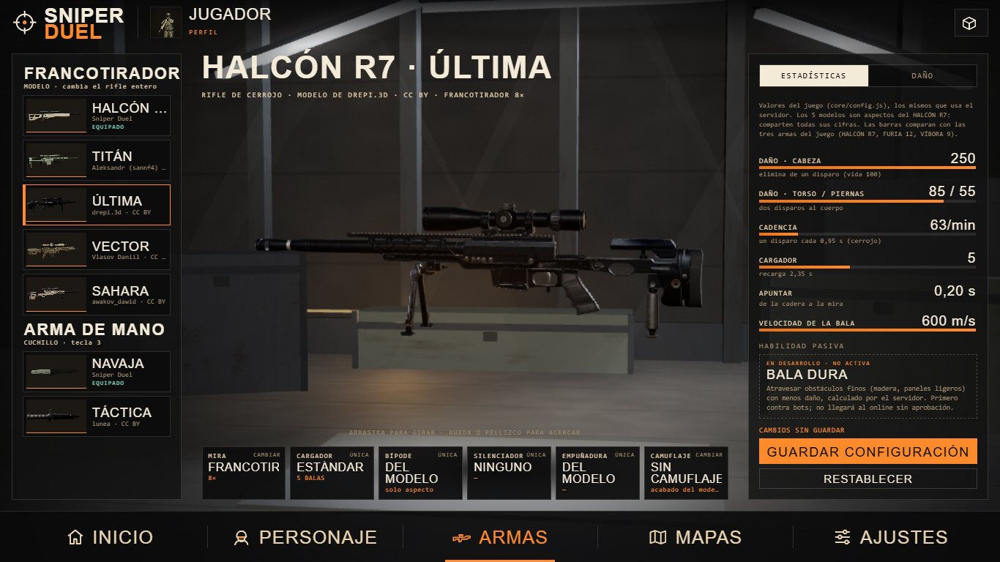
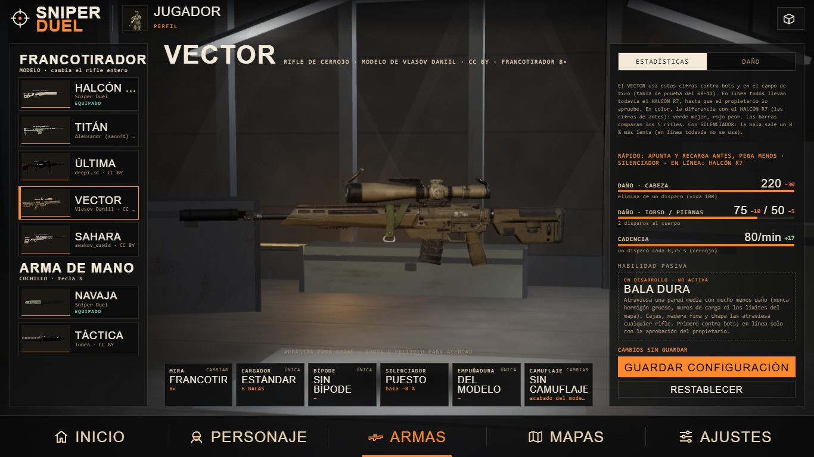
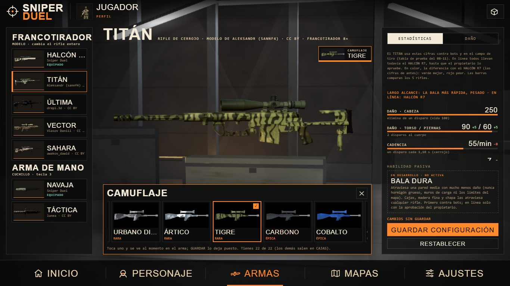
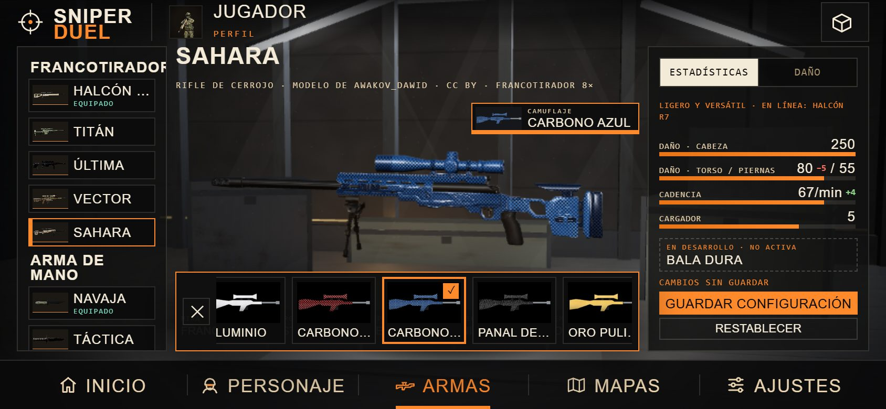
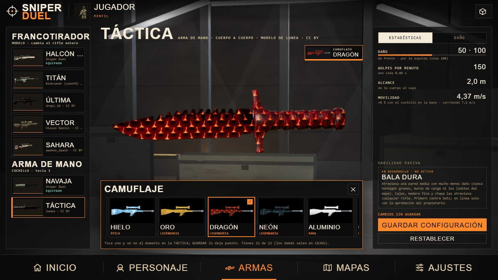
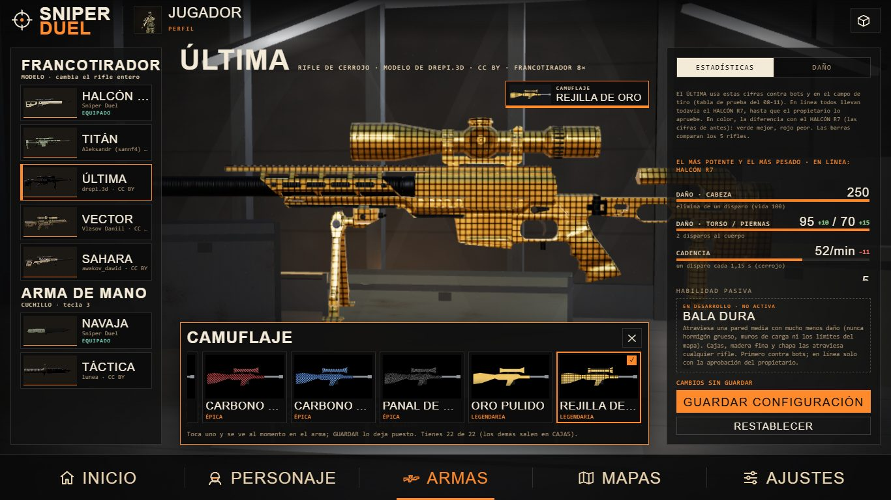
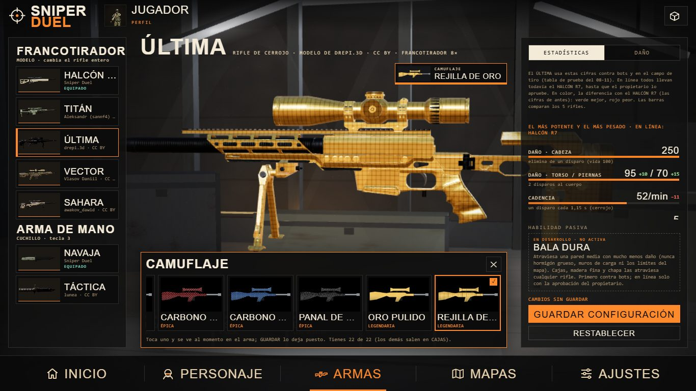

# GUNSMITH 2.0: el ARSENAL (08-11-2026)

**Estado:**
- **G1 y G2:** IMPLEMENTADO · PROBADO EN NAVEGADOR (PC con GPU y móvil en horizontal) · PENDIENTE DE VALIDACIÓN EN IPHONE.
- **Rifles distintos (09-11):** IMPLEMENTADO · PROBADO EN NAVEGADOR (contra bots) · solo sin conexión: en línea, todos con el
  HALCÓN R7 hasta que el propietario lo apruebe. `?balance=0` vuelve a las cifras de antes.
- **Silenciador (09-11):** IMPLEMENTADO · PROBADO EN NAVEGADOR (contra bots) · solo sin conexión.
- **G4 y G5:** hechos en parte (ver las tablas de abajo).
- **G6 y G7 (BALA DURA):** IMPLEMENTADO · PROBADO (servidor con red simulada y 1v1 en el navegador). En línea desde el
  10-11-2026, con los daños aprobados por el propietario («sí, está bien»): ver «Penetración y BALA DURA en línea».
- **G3 y G8:** pendientes (plan y decisiones al final).
- **El ARMAS de antes:** `?arsenal=0` (se recuerda; `?arsenal=1` vuelve al ARSENAL).

Encargo del propietario (08-11): «un sistema GUNSMITH profesional… que todo lo que el jugador seleccione tenga un resultado
real y verificable… Empieza por G1 y G2. Resuelve primero las skins y el nuevo HUD». Prioridad: «primero que el rifle, los
accesorios y las skins se vean y funcionen perfectamente en el arsenal; después BALA DURA».

## G1 · Auditoría: por qué «las skins no cargan o no coinciden»
Medido en el PC con `.work`/auditoría (página real, servidor local):

| Modelo | Primera descarga | Hasta verse (modelo ligero) | Hasta verse entero | Texturas en la GPU |
|---|---|---|---|---|
| HALCÓN R7 | — (viene con el juego) | al momento | al momento | 44 MB en total |
| TITÁN | 38 MB | 2,5 s | 30 s | 188 MB |
| ÚLTIMA | **139 MB** | 1,6 s | 34 s | **454 MB** |
| VECTOR | 60 MB | 3,5 s | 21 s | 220 MB |
| SAHARA | 33 MB | 1,3 s | 11 s | 188 MB |

1. **El camuflaje tapaba el modelo.**
   - Era el fallo de la captura del propietario: la ÚLTIMA se veía dorada (REJILLA DE ORO) y no se parecía a su miniatura.
   - El camuflaje era uno para todas: se pintaba encima de cualquier modelo.
   - **Arreglo:** cada modelo guarda su camuflaje. Un modelo nuevo empieza «SIN CAMUFLAJE», con su acabado de verdad.
2. **Las miniaturas de las miras mentían:** siempre enseñaban la mira sobre el HALCÓN.
   - **Arreglo:** 32 fotos nuevas, cada mira montada en cada modelo por el propio juego
     (`tools/miras/retratos-modelos.js` → `assets/miras/<modelo>/<mira>.jpg`).
3. **El peso de las versiones 4K** (ÚLTIMA: 139 MB de descarga y 454 MB en la GPU).
   - En el PC carga en 11–34 s.
   - En un iPhone puede tardar mucho o quedarse sin memoria.
   - Mientras llega se ve el modelo ligero (CARGA PROGRESIVA) con su porcentaje.
   - **No lo he bajado de resolución sin medirlo en el iPhone**: el propietario pidió 4K y el 04-11 dijo que las armas cargaban
     bien en su iPhone. Si falla allí, la propuesta es una versión 2K para móvil (¼ de memoria).
4. **Sin fallo:** la selección se guarda bien al recargar, no faltan archivos y no hay errores.
5. **Los rivales y los bots siguen viendo el HALCÓN.** Ya estaba así. Arreglarlo es mandar el modelo elegido por el protocolo:
   un cambio del servidor, solo de aspecto (G7).

## G2 · El ARSENAL nuevo
- **En el centro, el arma grande:** la de tus manos, con su modelo, mira y camuflaje.
  - Se gira arrastrando, de lado y arriba/abajo.
  - Se acerca con la rueda o pellizcando (doble clic: vuelve).
  - El operador no sale aquí.
- **A la izquierda, los MODELOS** (cambian el rifle entero) y los cuchillos, con su retrato real (`tools/arma-retratos.js`) y la
  marca EQUIPADO.
- **Debajo del arma, seis botones:** MIRA, CARGADOR, BÍPODE, SILENCIADOR, EMPUÑADURA y CAMUFLAJE.
  - Cada uno abre un selector pequeño con **solo lo que existe**.
  - MIRA: las 8 miras, en fotos del modelo elegido.
  - CARGADOR, BÍPODE, SILENCIADOR y EMPUÑADURA tienen hoy una sola opción (la del modelo) y lo dicen (llegan en G3).
  - CAMUFLAJE: los de tu cuenta («SIN CAMUFLAJE» sin cuenta).
- **A la derecha, ESTADÍSTICAS y DAÑO,** con las cifras del juego (ver G5), y la HABILIDAD PASIVA: BALA DURA «EN DESARROLLO · NO
  ACTIVA», que no se puede elegir.
- **GUARDAR CONFIGURACIÓN / RESTABLECER:**
  - Lo que eliges es un borrador: se ve al momento en el arma y no se guarda.
  - GUARDAR lo guarda: el modelo, el cuchillo y, por modelo, su mira y su camuflaje.
  - RESTABLECER vuelve a lo guardado.
  - Si sales de ARMAS sin guardar, vuelve lo guardado y al volver te lo dice.
- **Dónde se guarda:**
  - las claves de siempre (`sniperduel_wsRifle`, `sniperduel_wsKnife`, `sniperduel_mira`);
  - lo de cada modelo, en `sniperduel_gsCfg`;
  - el camuflaje, en tu cuenta: lo confirma el servidor, que solo deja equipar lo que tienes.
- Grafito y negro con acentos naranjas. En el móvil en horizontal (844 × 390) todo cabe entre las dos barras.

## G5 · Estadísticas reales: una sola fuente
- **Antes:** el daño por distancia estaba en `core/room.js` (servidor) y **copiado dos veces** en la página (partidas contra bots).
- **Ahora:** `core/gunstats.js` es la única fuente.
  - El servidor (`core/room.js`: `const dmgAt = GS.dmgAt`) y la página (`SDGunStats.dmgAt`) usan la misma cuenta.
  - El ARSENAL enseña lo que sale de ella:
    - ficha: daño por zona, cadencia, cargador, recarga, apuntar, velocidad, alcance y movilidad;
    - tabla de daño a 10–450 m, con los disparos para eliminar;
    - caída de la bala y tiempo de vuelo, con la misma balística de las balas del servidor (`core/weapon.js`).
- **Los 2 cuchillos son aspectos** (las cifras de la NAVAJA). Los 5 rifles tienen sus cifras desde el 09-11 (abajo).
- Las barras comparan los 5 rifles.
- **No cambia ningún número.** La sala del servidor da los mismos resultados (`room.test` 155/155, `pistol` 15/15, `shotgun`
  27/27).

## Pruebas
- `node test/gunstats.test.js` (15):
  - la ficha es la de `core/config.js`;
  - la caída de la pistola y la escopeta;
  - la balística es igual que la de una bala del servidor a 100, 200 y 300 m;
  - el servidor y la página usan `core/gunstats.js`;
  - en una sala real del servidor, los impactos a cabeza, torso y piernas quitan lo que dice el ARSENAL.
- `node test/arsenal.browser.test.js` (24, con la GPU; `GPU=0` en software):
  - el ARSENAL en lugar de ARMAS;
  - borrador, guardar, restablecer, salir sin guardar, mira por modelo y recarga de la página;
  - miniaturas de la mira del modelo (sin 404);
  - accesorios sin alternativas y camuflaje sin cuenta;
  - cifras iguales a las de `core/gunstats.js`;
  - cuchillo, girar y acercar, `?arsenal=0` y móvil.
- `test/menu2.browser.test.js` sigue probando el ARMAS de antes, con `?arsenal=0`.
- **Capturas:** `node tools/capture-arsenal.js CARPETA` (PC y móvil; `GPU=0` en software).

## Lo que falta (plan por fases)
| Fase | Qué | Necesita al propietario |
|---|---|---|
| **G3** | Modelos de accesorio hechos por código (como las miras): silenciador, bípode, empuñaduras, cargadores. Montados en los puntos de cada modelo (boca del cañón `info.muzzle`, raíl, guardamanos). Primero **solo aspecto**. | Que el silenciador cambie el **sonido** y quite el **fogonazo** cambia el juego (en un 1 contra 1 el sonido delata): necesita aprobación, igual que cualquier efecto del bípode, la empuñadura o el cargador. |
| **G4** | Hecho: modelo, mira y camuflaje por modelo. Falta: los accesorios de G3 y la pasiva, cuando existan. | — |
| **G5** | Hecho para el rifle y el cuchillo. Falta: comparar con FURIA 12 y VÍBORA 9 en la misma tabla. | — |
| **G6** | BALA DURA, prototipo **contra bots**, detrás de una bandera. | El diseño de abajo |
| **G7** | BALA DURA en el servidor (salas de prueba) y el modelo elegido visible para el rival. | Aprobación antes de activarla en el 1 contra 1 |
| **G8** | Medir memoria y FPS antes/después en PC e iPhone; versión 2K de los modelos para móvil si hace falta. | Probar en su iPhone |

### Decisiones del propietario (08-11-2026, tras ver el ARSENAL publicado)
Sus palabras: «Sin silenciador que se escuche el tiro dependiendo de la distancia, que es un francotirador; con silenciador que
no se vea el fogonazo o que no delate la ubicación; diferentes accesorios». Y sobre BALA DURA: «el ÚLTIMA es el más bueno y
pesado que tengo… ¿en la vida real no atraviesa cajas, madera fina o chapa? Eso ya lo hace. Lo de la BALA DURA es para las
paredes medio gruesas o gruesas; obviamente que no pase por 2 paredes gruesas».
- **Sin silenciador:** ya pasa hoy y se queda así.
  - El tiro del rival se oye más o menos según la distancia, desde su dirección y con el retraso del sonido.
  - Su posición sale 3 s en tu minimapa.
  - Los bots del servidor lo oyen hasta 90 m.
- **Con silenciador** (aprobado):
  - sin fogonazo;
  - sin el punto en el minimapa del rival;
  - un sonido bajo que no dice de dónde viene;
  - los bots solo lo oyen muy cerca.
  - El servidor sabe quién lo lleva: lo manda en el evento del disparo, así ningún cliente puede fingirlo.
- **Penetración de serie:** las balas de francotirador atraviesan lo fino sin ninguna habilidad: cajas, madera fina y chapa.
- **BALA DURA** cambia de sentido: es para paredes **medio gruesas o gruesas**, una como mucho (nunca dos gruesas).
- **Sus respuestas:** rifles distintos, con pros y contras; el silenciador con un precio pequeño (bala un 8 % más lenta);
  BALA DURA como pasiva para cualquier rifle.

## Rifles distintos (09-11-2026): cada modelo con su personalidad
Del propietario: «Apruebo provisionalmente la tabla de los cinco francotiradores… para pruebas experimentales», «Mantén el
daño propuesto», «el VECTOR debería sentirse rápido, el TITÁN pesado y potente, y el HALCÓN equilibrado», «Primero implementa
y prueba contra bots. No actives el nuevo balance… en el multijugador público hasta que yo lo pruebe y lo apruebe» y
«Conserva las estadísticas anteriores para poder comparar y revertir».

| Rifle | Perfil | Cabeza / torso / piernas | Cerrojo | Cargador | Recarga | Apuntar | Bala | Andar | Balanceo | Retroceso |
|---|---|---|---|---|---|---|---|---|---|---|
| HALCÓN R7 | equilibrado (el de antes) | 250 / 85 / 55 | 0,95 s | 5 | 2,35 s | 0,20 s | 600 m/s | × 1 | 4,2 mrad | 100 % |
| TITÁN | largo alcance, pesado | 250 / 90 / 60 | 1,10 s | 7 | 2,80 s | 0,26 s | 720 m/s | × 0,93 | 3,8 mrad | 115 % |
| ÚLTIMA | el más potente y pesado | 250 / 95 / 70 | 1,15 s | 5 | 2,70 s | 0,28 s | 680 m/s | × 0,88 | 3,4 mrad | 125 % |
| VECTOR | rápido, pega menos | 220 / 75 / 50 | 0,75 s | 6 | 2,10 s | 0,16 s | 560 m/s | × 1,05 | 4,8 mrad | 85 % |
| SAHARA | ligero y versátil | 250 / 80 / 55 | 0,90 s | 5 | 2,20 s | 0,18 s | 610 m/s | × 1,03 | 4,4 mrad | 100 % |

Todos matan de un disparo a la cabeza y de dos al cuerpo (vida 100).

- **Dónde:** `core/config.js` (`rifles.titan`, `ultima`, `vector`, `sahara`; el HALCÓN no cambia).
- **Cuándo cuenta:** al aparecer, el modelo que llevas decide las cifras (`applyRifleCfg` en la página):
  - contra bots y en el campo de tiro, las suyas;
  - en línea, siempre el HALCÓN (el servidor solo conoce `rifles.halcon`);
  - los bots y el rival en línea llevan el HALCÓN.
- **Se nota en todo:** cerrojo, recarga, apuntar, cargador (y su HUD), velocidad de la bala, balanceo de la mira, retroceso.
  - La velocidad al andar con el rifle en la mano va por `core/melee.js` `speedMul(L, rc)`.
  - El HALCÓN no tiene `moveMul`, así que el servidor anda igual que antes.
- **El ARSENAL** enseña las cifras del modelo:
  - en color, la diferencia con el HALCÓN R7 (verde mejor, rojo peor);
  - el perfil y «EN LÍNEA: HALCÓN R7»;
  - la tabla de DAÑO del modelo;
  - el CARGADOR del accesorio, el del modelo.
- **Comparar y volver atrás:** `?balance=0` (se recuerda) pone las cifras de antes a todos los modelos sin conexión, y el
  ARSENAL dice «HALCÓN R7 · VECTOR». `?balance=1` lo deshace.
- **Pruebas:**
  - `test/rifles.browser.test.js` (27, con la GPU):
    - las 11 filas de cada modelo;
    - la personalidad frente al HALCÓN;
    - medido con el reloj del juego, el VECTOR: cerrojo 0,758 s, recarga 2,108 s, apuntar 0,160 s y 4,25 m/s andando
      (el tick del juego suma 8 ms);
    - con `?balance=0`, lo mismo con las cifras del HALCÓN.
  - `test/gunstats.test.js` (20): la tabla aprobada, la velocidad del TITÁN en el tick compartido y que el servidor no lee
    otros rifles.
  - `test/online.browser.test.js` (48): con el VECTOR elegido, en una partida en línea real se juega con el HALCÓN.
- **Falta su prueba y su aprobación** para llevarlo al online. Eso mandaría el modelo de cada jugador al servidor y
  cambiaría `core/room.js`.

### BALA DURA: primera propuesta (SUSTITUIDA por las decisiones de arriba)
- **Solo lo marcado como penetrable:** cajas del mapa con superficie `wood` (madera fina) o paneles de metal ligero, y un grosor
  máximo (por ejemplo 0,12 m de madera, 0,04 m de chapa).
  - El grosor real es el que recorre la bala dentro de la caja, así que un ángulo rasante lo aumenta.
  - Hormigón, piedra, estuco, paredes gruesas y límites del mapa: nunca.
- **Datos:** hoy las cajas del mapa tienen superficie (`f`), pero no «penetrable».
  - Se añadiría un campo `pen` solo a las cajas elegidas a mano en cada mapa: lista revisable, sin cambiar ninguna cobertura.
  - Se exportaría a `core/mapdata.js` con el resto.
- **Cuenta del servidor** (nunca del cliente):
  - Al chocar con una caja `pen`, se calcula por dónde sale la bala (entrada y salida de la caja).
  - Si el grosor cabe y no ha atravesado ya otra, la bala sigue con menos energía: daño × 0,5–0,6 y alcance recortado.
  - Como mucho una superficie.
- **Aviso:** marca de penetración en la pared y un sonido distinto, sin marcadores que revelen a nadie.
- **Reglas iguales para los dos:**
  - primero contra bots;
  - luego en salas de prueba;
  - en el 1 contra 1 público, solo con aprobación del propietario.

## El SILENCIADOR (09-11-2026, contra bots)
Del propietario: «con silenciador que no se vea el fogonazo o que no delate la ubicación», con «un precio pequeño» (eligió la
bala un 8 % más lenta).

- **En el ARSENAL:** la ranura SILENCIADOR tiene dos opciones, NINGUNO y SILENCIADOR.
  - Se ve al momento en el arma y se guarda por modelo con GUARDAR (`sniperduel_gsCfg`, `muzzle: 'sil'`).
  - Las cifras lo reflejan: la bala del HALCÓN pasa de 600 a 552 m/s, y la pestaña DAÑO da más caída y más tiempo de vuelo.
- **El modelo:** un tubo mate hecho por código (`silBuild`, 6 piezas, sin texturas) en la boca del cañón de cada modelo, en el
  mismo punto que el fogonazo (`RIF.flash`).
- **Con él, contra bots y en el campo de tiro:**
  - sin fogonazo, sin el destello de luz y sin el destello del visor; casi sin humo;
  - un tiro seco y bajo (`SFX.shotSup`) en lugar del estampido;
  - los bots solo lo oyen a menos de 20 m (sin él, hasta 85 m);
  - el precio: la bala sale un 8 % más lenta.
  - Ya está hecho el sonido lejano bajo y sin dirección para el rival (`SFX.distantSup`), para cuando llegue al online.
- **En línea, todavía no:** ni se monta ni cuenta, igual que los rifles nuevos.
  - Llevarlo al online es G7: el servidor sabría quién lo lleva y lo mandaría en el evento del disparo, sin punto en el
    minimapa del rival y con el sonido bajo. Necesita su aprobación.
- **Pruebas:**
  - `test/rifles.browser.test.js`: se monta, se guarda, sigue tras recargar. Disparando con un bot vivo a 40 m: con
    silenciador no hay fogonazo ni luz, suena el tiro bajo, la bala va a 552 m/s y el bot no se entera; sin él, todo lo
    contrario.
  - `test/online.browser.test.js`: con el VECTOR y su silenciador guardados, en línea se juega con el HALCÓN sin silenciador.
- **Capturas:** `node tools/capture-silenciador.js CARPETA` (ARSENAL y en la mano, sin y con, al disparar).
- **Falta:** el silenciador en el arma en tercera persona (vista 3ª y rival), con G7.

## Arreglos tras la prueba del propietario (09-11-2026, tarde)
Del propietario, con capturas: «el camuflaje de rejilla de oro no me gusta, las líneas negras son demasiado gruesas»,
«en TITÁN falta ajustar un poco hacia abajo el silenciador», «en la pantalla MAPAS no cargan bien los mapas», «a la arma
de mano también añade los camuflajes (a la navaja de SNIPER DUEL no hace falta)», «en PERSONAJE… si quieres añade botón
pero no vamos a añadir camuflajes de personajes ahora», «el personaje MILITAR le faltan rodillas», «en ARMAS cambia de
sitio el botón de camuflaje», «si elijo algún camuflaje que pueda verlo en tiempo real y si no me gusta elegir otro, sin
tener que estar cerrando y abriendo; tiene que funcionar en PC y móvil».

- **CAMUFLAJE, en vivo:**
  - Sale de la fila de accesorios (ahora 5 ranuras) a su propio botón, junto al nombre del arma.
  - Abre una tira de una fila abajo (con el dedo, o con la rueda en el PC, se desplaza de lado). El arma sube por
    encima de la tira y se ve entera.
  - Tocar un camuflaje lo pinta al momento y la tira sigue abierta. Para probar otro, se toca otro.
  - Girar el arma o cambiar de modelo no la cierra; la cierran ✕ o su botón.
  - GUARDAR lo deja puesto, igual que antes.
  - En el móvil en horizontal la tira es una sola fila de fotos, con ✕ a la izquierda y sin título ni rareza. Mide 76 px
    y deja 125 px para el arma (medido a 844 × 390).

  
  
- **La TÁCTICA lleva camuflaje** (hoja y mango), con los mismos camuflajes de la cuenta.
  - El dibujo se repite cada ~7 cm (`KCAMO_SCALE` = 15; el rifle, cada 20 cm). Si no, en una hoja de 20 cm solo se veía
    una mancha. `SDCamo.patch` acepta ya la escala.
  - Se guarda en el dispositivo, por cuchillo (`sniperduel_gsCfg.knives`).
  - Se ve en la mano, en partida (`kcamoApply`). La NAVAJA no lleva: con ella el botón no sale.
- **PERSONAJE:** botón «CAMUFLAJE DEL OPERADOR · PRÓXIMAMENTE», desactivado.
  
- **REJILLA DE ORO** (`assets/camo/oro_rejilla.jpg`):
  - Las líneas pasan de unos 10 px negros a unos 4 px de dorado oscuro, y el oro queda debajo.
  - La foto de antes está en git, y en `.work/camo-antes/` en el PC.

  
  
- **Capturas:** `node tools/capture-camo.js CARPETA [rejilla_de_antes.jpg]`.
- **Silenciador del TITÁN (y del VECTOR):**
  - La boca del cañón (`muzzle` de `assets/armas/<id>/info.json`) estaba a la altura del cerrojo, no en el centro del
    cañón. Medido sobre la malla: el TITÁN 1,4 cm por encima, el VECTOR 0,8 cm.
  - Ahora es el centro medido: TITÁN y = 0,0132, VECTOR y = 0,0237. Mueve el silenciador y el fogonazo; la bala no.
  - ÚLTIMA (0,6 cm) y SAHARA (0,1 cm) se quedan como estaban: el propietario las dio por buenas.
  - Ojo: `tools/arma-ext/arma.py` pone la boca a la altura del cerrojo. Si se regeneran el TITÁN o el VECTOR, hay que
    volver a medir.
- **Pruebas:**
  - `test/arsenal.browser.test.js`:
    - la tira, de una fila, con el arma por encima;
    - pintar al momento sin cerrar; girar sin cerrar; SIN CAMUFLAJE;
    - la TÁCTICA pintada y guardada, también tras recargar; la NAVAJA sin botón;
    - en el móvil en horizontal, que la tira cabe.
  - `test/menu2.browser.test.js`: MAPAS con 5 mapas.

## Penetración y BALA DURA (09-11-2026, contra bots)
Lo pidió el propietario el 08-11 (sección «Decisiones del propietario»): de serie, la bala atraviesa cajas, madera fina y
chapa; BALA DURA, una pared media como mucho, nunca dos.
- **Una sola fuente: `core/pen.js` (`SDPen`)**, pura y compartida (Node y navegador). El servidor todavía no la usa.
  - `classify(superficie, grosor)`:
    - **finas:** cajas de madera (de cualquier tamaño), madera de hasta 12 cm y chapa de hasta 10 cm;
    - **medias:** tabiques de yeso de hasta 20 cm;
    - **nunca:** hormigón, muros de yeso más gruesos (de carga), tierra, sacos y límites del mapa.
  - `through(caja, origen, dirección)`: por dónde entra y sale la bala de la caja, con el giro de la caja. Un ángulo rasante
    alarga el recorrido dentro: un tabique cruzado con más de 45 cm dentro para la bala.
  - `pass(estado, clase, recorrido, baladura)`:
    - como mucho 2 superficies, y de ellas una sola media (solo con BALA DURA);
    - daño × 0,75 por cada fina y × 0,5 por la media.
- **Cifras propuestas, contra bots:** 75 % y 50 %. **Son de equilibrio:** para llevarlas al online hace falta la aprobación
  del propietario.
- **En la página (`updateBullets`):**
  - La bala de rifle (no la pistola, ni los perdigones, ni en línea) lleva su estado de penetración.
  - Si choca con una caja del mapa que puede atravesar, deja la marca, sale por el otro lado y sigue en el mismo paso
    (como mucho 4 tramos por paso).
  - Se usan siempre las cajas de balas del mapa (`penBox`: cajas rectas o giradas en Y), nunca lo que se ve.
  - En el PUEBLO las cajas se cambian por modelos, pero `hideOld` recuerda que eran cajas (`penSurf`).
- **No delata a nadie:** un impacto a través de una pared no da marcador ni el aviso IMPACTO (sí la sangre en el bot y, si
  muere, la baja).
- **BALA DURA:**
  - Se enciende y se apaga en ARMAS › HABILIDAD PASIVA (ACTIVAR / QUITAR), para cualquier rifle, contra bots.
  - Se guarda en el dispositivo (`sniperduel_balaDura`). En línea, no.
- **Banderas:** `?pen=0` apaga la penetración (se recuerda); `?pen=1` la vuelve a poner.
- **Medido en los mapas reales:**
  - PUEBLO: 31 cajas finas. ARENA: 10.
  - CASA ATLAS: 53 tabiques medios, 2 maderas y 1 chapa finas.
  - CASA ATLAS 2.0: 212 tabiques medios, 8 maderas y 4 chapas finas.
  - Hormigón penetrable: 0.
- **Pruebas:**
  - `test/pen.test.js` (18): clases, entrada y salida, rasante, giro, límites.
  - `test/pen.browser.test.js` (13): con el motor de verdad.
    - Un bot detrás de una caja del PUEBLO recibe el 75 % y no hay marcador.
    - Detrás de un tabique de CASA ATLAS: 0 sin BALA DURA, la mitad con ella.
    - Ni un mueble macizo ni el hormigón dejan pasar la bala.
    - El interruptor del ARSENAL, y `?pen=0`.
- **Falta (con su aprobación):** llevarlo al servidor (G7).
  - `tools/export-map.js` tendría que exportar la superficie de cada triángulo y su caja.
  - `room.js` usaría `SDPen` igual que la página.

## BALA DURA por grosor, MAPA DE PRUEBAS y RAYOS X (09-11-2026, noche)
Del propietario, con una captura de la columna de ARENA: «si la pared es como la mitad, sí puede traspasar la bala, pero si
es tan grande como la de ARENA la bala no pasa; no sé la relación de daño; hazme un mapa aparte con bots inmóviles detrás de
paredes… y dame rayos X para saber dónde apunto».
- **Regla nueva de BALA DURA** (`core/pen.js`):
  - Pasa una pared de hasta **50 cm** (la mitad de la columna de 1 m de ARENA), del material que sea: yeso, hormigón,
    madera o chapa.
  - Nunca pasa: sacos, tierra, edificios macizos, la columna de 1 m, los muros de 60 cm ni los del borde del mapa.
    Tampoco dos paredes seguidas.
  - **El daño baja con lo que la bala recorre dentro** (`mulMedium`): × 0,70 con 12 cm, × 0,65 con 18 cm, × 0,56 con
    30 cm y × 0,40 con 50 cm; nunca menos de × 0,35. Es mi propuesta («no sé la relación de daño»): se ajusta probando
    en el mapa de pruebas.
  - Lo fino (cajas, madera de hasta 12 cm, chapa de hasta 10 cm) sigue igual: cualquier rifle, × 0,75.
- **Superficie de cada caja:** en el PUEBLO las cajas se cambian por modelos; `hideOld` guarda antes lo que eran
  (`penSurf`). Las demás usan `surfaceOf`.
- **MAPA DE PRUEBAS** (MAPAS › PRUEBAS, solo contra bots; nunca va al servidor, `local: true`):
  - Diez paredes con su rótulo: caja de madera, madera de 8 cm, chapa de 6 cm, yeso de 18 cm, hormigón de 30, 50 y
    60 cm, columna de 1 m, sacos de 80 cm y dos tabiques.
  - Detrás de cada pared, un bot quieto que ni se mueve ni dispara, en la línea que va desde tu punto de salida, a 18 m.
  - En ese mapa, un impacto a través de una pared sí dice el daño («A TRAVÉS · YESO −59 (65 % del daño)»).
- **RAYOS X** (solo en el mapa de pruebas y sin conexión):
  - Las zonas de impacto de cada bot (las cajas que cuentan para la bala) se ven a través de todo: el cuerpo en naranja
    y la cabeza en rojo.
  - `?rayosx=0` las quita.
- **Medido con el motor del juego** (HALCÓN, 85 al torso; desde tu punto de salida):
  - Sin BALA DURA: 64 en caja, madera y chapa; 0 en lo demás.
  - Con BALA DURA: además yeso 55, hormigón de 30 cm 47 y de 50 cm 33. El de 60 cm, la columna, los sacos y el segundo
    tabique paran la bala.
- **Pruebas:**
  - `test/pen.test.js` (20).
  - `test/pen.browser.test.js`:
    - el mapa de pruebas entero, sin y con BALA DURA;
    - los rayos X;
    - el deslizamiento nuevo;
    - que en los mapas reales nada de más de 50 cm se atraviese.

## Penetración y BALA DURA en línea (G7, 10-11-2026)
El propietario aprobó los daños («sí, está bien»): × 0,75 por superficie fina; con BALA DURA, una pared de hasta 50 cm
de × 0,7 (12 cm) a × 0,4 (50 cm); como mucho 2 superficies y una sola media.
- **Servidor** (`core/room.js`): la bala del rifle (no la escopeta ni la pistola) lleva `b.pen`. Al dar en el mapa
  busca la caja atravesable cuya cara está en ese punto (`penBoxAt`), `core/pen.js` decide si pasa, y la bala sigue
  desde la otra cara con menos daño (hasta 4 tramos por tick). El evento `hit` lleva `thru` si atravesó algo.
- **Mapa del servidor** (`core/mapdata.js` `pen`): `tools/export-map.js` exporta lo que dice `penBox()` de la página
  para cada malla de balas (PUEBLO 57 cajas, ARENA 11, CASA 67, CASA 2.0 260–276, BARRIO 22). El resto del mapa no
  cambia (comprobado triángulo a triángulo).
- **Protocolo** (`core/protocol.js`): un bit nuevo en el comando, `hard` (4096), «este tiro lleva BALA DURA». Basta con
  que el cliente lo diga: es una pasiva que cualquiera puede elegir en el ARSENAL, como un arma.
- **Página:** manda `cmd.hard`, dibuja la trazadora atravesando también en línea y, si el impacto llega a través de
  algo (`thru`), no da marcador ni aviso al que dispara (igual que contra bots). El que recibe el tiro lo nota como
  siempre.
- **Pruebas:** `test/penroom.test.js` (servidor con dos clientes: caja fina del PUEBLO al 75 %; pared media de CASA
  sin BALA DURA se para, con ella pasa con × 0,65 con 18 cm), más `room`, `core`, `pen`, `pen.browser` y `online`.
